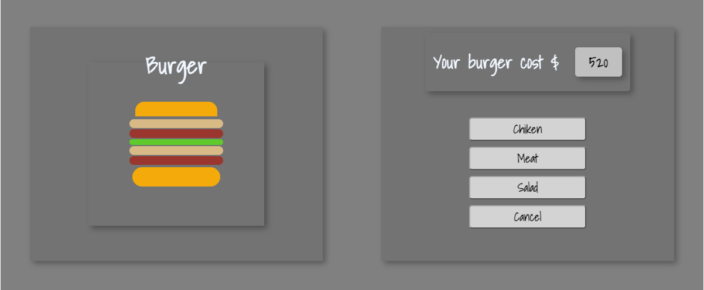

# testBurger

A tiny burger shop in the browser. I made it to learn JavaScript.

Click **Chiken**, **Meat**, or **Salad**. The burger grows. The price goes up. Press **Cancel** and it is just bread again ($20).

Open `index.html` in a browser. No install. No build. Just a hungry page.

Built in 2019 with HTML, CSS, and plain JavaScript.
